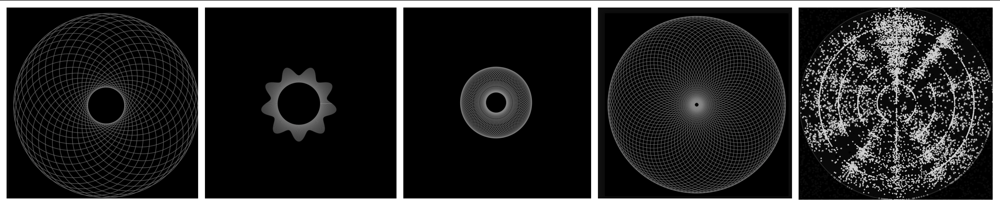

# Visualizing Frequency: Chladni Plates vs. Parametric Geometry

This repository contains two browser tools that explore two entirely different ways of visualizing sound, vibration, and frequency: the Chlandi plates sim is with a basic physic engine, and the parametric geomtery visualized using direct math translations.

### 1. The Physical Simulation (`index_v1.html`)
This is a particle-based Chladni plate simulator. In the real world, if you run a bow across a metal plate covered in sand, the plate vibrates at specific resonant frequencies. The sand bounces around until it settles into the "nodes"—the exact geometric lines where the standing waves cancel each other out and the vibration is zero.
* Uses 2D standing wave approximations to calculate anti-nodes and zero-points.
* Simulates thousands of independent particles calculating their local gradients and drifting toward the nodal dead zones.
* Chaotic, and organic. It takes time for the patterns to resolve as the particles fight digital friction to find their resting places.

### 2. The Parametric Generator (`index.html`)
This is a mathematical rendering engine. Instead of simulating physical matter reacting to sound, it draws the underlying math of the frequencies themselves. 
* Abandons particles entirely in favor of trigonometric rendering (`Math.sin`, `Math.cos`).
* Generates high-frequency polar waveforms and intersecting mandala geometry.
* Clean, and infinite. It produces the kind of vector art you see in digital generative art.

## The Connection: Why They Belong Together

At first glance, sand particles and perfect vector lines look like they have nothing in common. But they are two sides of the exact same coin. 
Both tools are driven by the same fundamental parameters: `Frequency` and `Amplitude`. 

The parametric generator shows you the **ideal**—how a wave looks when mathematically derived. The Chladni simulator shows you the **reality**—how that exact same math forces physical matter to react in the real world. 

## The Significance of Simplicity

There is no AI generating these images. There are no massive data sets or neural networks. The beauty in these patterns comes entirely from **emergent complexity**. By taking incredibly simple, foundational rules—a sine wave intersecting with another sine wave, or a particle moving away from a high value toward a low value—and repeating them thousands of times, highly complex, deeply symmetrical, and mesmerizing patterns emerge naturally.

It is a reminder that you don't need heavy computational brute force to create something beautiful. You just need to set up the right boundaries, apply a frequency, and watch as complexity becomes part of the emergent property of the system. 

## How to Run
Just clone the repo and double-click either HTML file to open it in your browser.

[Click here]() to visualize the parametric generator on your browser now